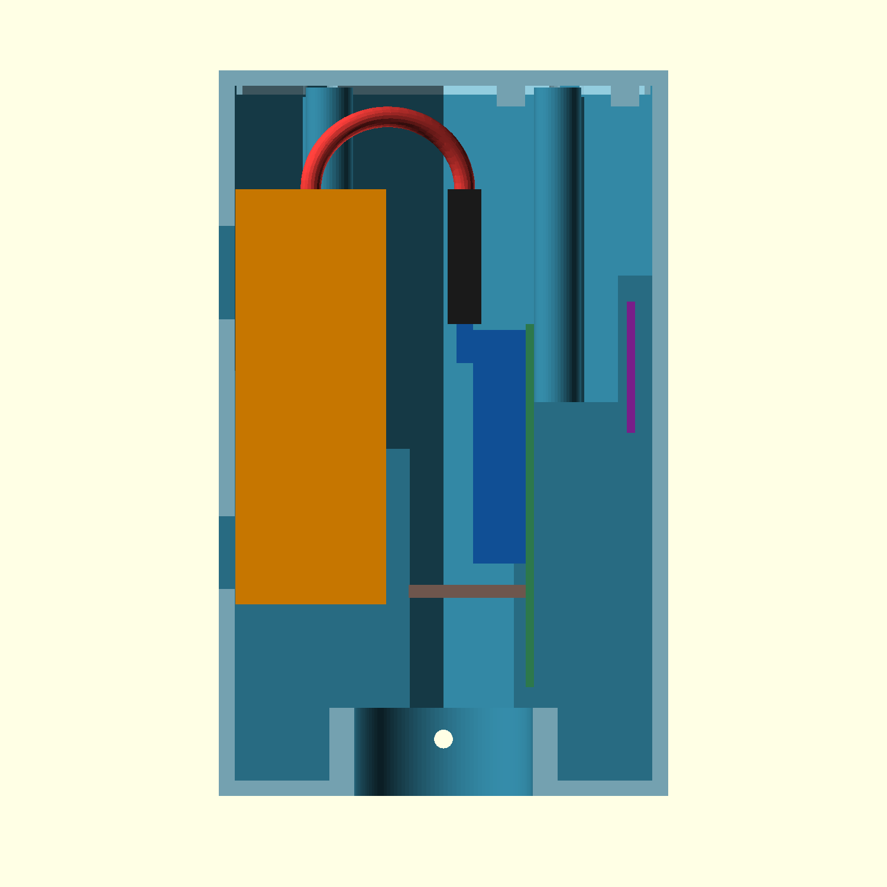

# Plan A v0.7: right head sized for the power bank's built-in cable

Status 2026-11-19: sized by calculation and checked in OpenSCAD. **Not printed and not fitted to any real part.** Prototype enclosure only; not verified for loads.

Source: `smart_dumbbell_planA_v07.scad`. It was built on the v0.6 draft, which is not in the repository; the header of the source file says what v0.6 took from where. Compared with v0.6, `head_right` changes and `cap_right` loses one unused slot. `head_left`, `cap_left`, `grip`, `max30102_carrier` and `fit_coupon` are the v0.6 geometry (v0.4 interfaces), exported here so that the folder is complete. STL files are binary.

## What changed from v0.6

| | v0.6 | v0.7 | Why |
|---|---|---|---|
| Right head depth | 121 | **140** | Room for the plug and the cable's U-turn above the Nano |
| Bank seat height | 21 | **37** | Bank's cable end level with the top of the plug, so the cable does not have to climb first |
| Hub board position (`board_y`) | 19.8 | **15.8** | Cable ends 32 mm apart instead of 36 |
| Windows in the −Y flat | one, z 92–110 | same, plus one at z 40–54 | Second one for the bank's display |
| 12 × 7 slot at the edge of the right cap | open | **closed** | Left over from v0.4, where it was meant for a USB-C panel extension. Here it sits above the bank's cable end and reaches nothing |
| Overall length | 331 | **350** | 70 + 140 + 140 |
| Right head, solid PLA upper bound | 219 g | 251 g | |

The depth is derived, not chosen: USB-C socket at 91 + plug 26 + bend 14 + cable 4 + clearance 2 = 137 inside, plus the 3 mm cap.

## How the bank goes in

Cable end towards the cap. Pad and display face against the −Y wall, so that the button and the display line up with the two windows. The cable leaves the bank's top end, makes a U-turn and its plug enters the Nano's USB-C socket from above.



Orange: bank. Red: cable. Black: plug. Blue: Nano on its sockets. Green: hub board. Brown: J1 with the 4209 plug. Purple: IMU.

## What is measured and what is assumed

Measured:

- Built-in cable length, 8–9 cm (Hanson, 2026-11-19). INIU lists 8 cm.
- Leads soldered to the hub board for the OLED, button, LED and pulse sensor: about 15 cm each (Hanson, 2026-11-19).

From INIU's product photos, not from the real unit:

- The cable is round and braided. It leaves one short end of the bank and docks into the same end as a ring.
- On the pad face, the button is near the cable end and the display is near the other end.
- The USB-C charging port is on the end opposite the cable.

Assumed, one parameter each:

| Parameter | Value | Effect if wrong |
|---|---|---|
| `plug_above`, stiff part of the plug above the socket | 26 | Head depth changes by the same amount |
| `cable_r`, height of the U-turn | 14 | Head depth changes by the same amount |
| `cable_d` | 4 | Head depth changes by the same amount |
| `bank_root_x`, cable root off-centre | 12 | Cable span changes by about 2 mm |
| Bank body | 80 × 38 × 29 | Pocket and seat |
| Button and display positions | 12 below the cable end, 10 above the other end | Windows miss; cut them by hand or set `side_win` / `disp_win` |

## Does the 8–9 cm cable reach?

The bendable length is the cable length minus the stiff plug (26 above the socket + 6.5 inside it). It has to cover a 32 mm span; the path drawn is 47 mm and the shortest possible, with 8 mm bends, is 41 mm.

| Cable length | Plug above socket | Bendable | Spare over the drawn path | Head depth |
|---|---|---|---|---|
| 80 | 26 | 47.5 | 0.3 | 140 |
| 85 | 26 | 52.5 | 5.3 | 140 |
| 90 | 26 | 57.5 | 10.3 | 140 |
| 85 | 22 | 56.5 | 9.3 | 136 |
| 85 | 30 | 48.5 | 1.3 | 144 |
| 80 | 30 | 43.5 | −3.7, still 2.3 above the shortest path | 144 |

It reaches in every case, but with an 8 cm cable and a long plug there are only a couple of millimetres in hand. That is the reason for the bench check below.

## Checks done

- `part="clash"` (right head against bank, board, Nano, J1 plug, USB plug, cable, IMU) renders empty.
- `part="clash_cap"` (installed cap against the same) renders empty.
- The right cap's outer face has seven openings: the 24 × 12 screen window, the 6.6 button hole, the 4.0 LED hole and four screw counterbores.
- All seven parts export as closed bodies with no errors.
- Clearances: J1 plug tip to the bank front 4.4 mm; bank front to the Nano 13.6 mm, which is where the pulse-sensor wires come up from the grip; cable top 4 mm below the rim.
- Mass: printed parts about 521 g as solid PLA (an upper bound), bank 115 g, boards, wires and screws about 60 g (estimate): about 700 g against the 1 kg limit.

None of these checks involve a real part.

## Before printing `head_right`

These checks were **not done** before this version was committed: the team chose to print first. The head is the longest print in the set, and two minutes with the real parts would settle the open numbers:

1. Measure the plug from its tip to where the cable can start to bend. Subtract 6.5. If the result is not 26 ± 2, set `plug_above` and re-export.
2. Reach test. Hold the bank next to the hub board with the Nano in its sockets: bank's cable end 26 mm above the board's USB edge, bank's nearest face 15 mm from the Nano. Plug the cable in. It has to reach without pulling on the socket, and the top of the loop must be no more than 18 mm above the bank's end.
3. Look at the real bank: is the button about 12 mm from the cable end and the display about 10 mm from the other end, both on the pad face? If not, change `side_win_z0` / `disp_win_z0` or set them to `false`.

## Things this version does not solve

- **Recharging.** From the photos the charging port is on the end that faces the grip, where nothing can be plugged in. The bank has to come out to be charged, or be charged through its own cable if it accepts input that way (not checked). The slot in the right cap that v0.4 provided for this could not reach the port in this orientation, so it is closed (`cap_bank_port=false`).
- **Leads to the cap.** The OLED, button and LED leads leave the board near z 32–34 and the cap is at 137, a run of about 105 mm. The 15 cm leads reach with about 45 mm of slack: enough to lift the cap and turn it on its side, not enough to lay it flat beside the head.
- **Pulse sensor leads.** The grip, unchanged from v0.4, has its 14 x 20 sensor window at mid-length, facing +Y. From there to J3 on the hub board is about 120 mm along the bore, so the 15 cm MAX30102 leads reach with about 30 mm of slack.
- **Assembly order.** The pulse-sensor leads are soldered to the hub board and have little slack, and the board goes in from the open end of the head. Slide the board into its slots first, then feed the sensor down the grip bore to the window. With the sensor fixed first, the board cannot be lifted high enough to enter the slots.
- The bank's own dimensions and the 4517's are still catalogue values.

## Printing

`Smart_Dumbbell_planA_v07_print_plate.stl` holds the six production parts in print orientation in one file; `PRINT_SHEET.md` is the page that goes to the print staff with it. Checked: six separate watertight bodies, each with the same volume as its single-part file, all sitting on z = 0, 3.2 mm smallest gap.

`Smart_Dumbbell_planA_v07_right_head_and_cap.stl` holds only the two parts that are new relative to the v0.4 set, which was already sent for printing: the right head and the right cap. It is the file submitted on 2026-11-19, with `PRINT_SHEET_right_head_and_cap.md`. The v0.4 `head_left`, `cap_left` and `grip` have the same mating dimensions (hexagon, wall, collar, grip clearance, lip clearance, screw positions and post radius were compared parameter by parameter) and are reused. The v0.4 `cap_right` would also fit, but it has three button holes and a 32 x 16 window, and its lip has to be trimmed at the four posts.

## Regenerate

```bash
openscad -o head_right.stl -D 'part="head_right"' smart_dumbbell_planA_v07.scad
openscad --export-format binstl -o Smart_Dumbbell_planA_v07_print_plate.stl -D 'part="plate"' smart_dumbbell_planA_v07.scad
openscad --export-format binstl -o Smart_Dumbbell_planA_v07_right_head_and_cap.stl -D 'part="plate_right"' smart_dumbbell_planA_v07.scad
openscad -o /tmp/clash.stl -D 'part="clash"' smart_dumbbell_planA_v07.scad      # must say the top level object is empty
openscad -o /tmp/clash_cap.stl -D 'part="clash_cap"' smart_dumbbell_planA_v07.scad
```

The console prints the derived depth and the cable figures. An assertion stops the render if the cable cannot reach.

Product reference: <https://iniushop.com/products/iniu-snapgo-p81-e1-power-bank-black>
