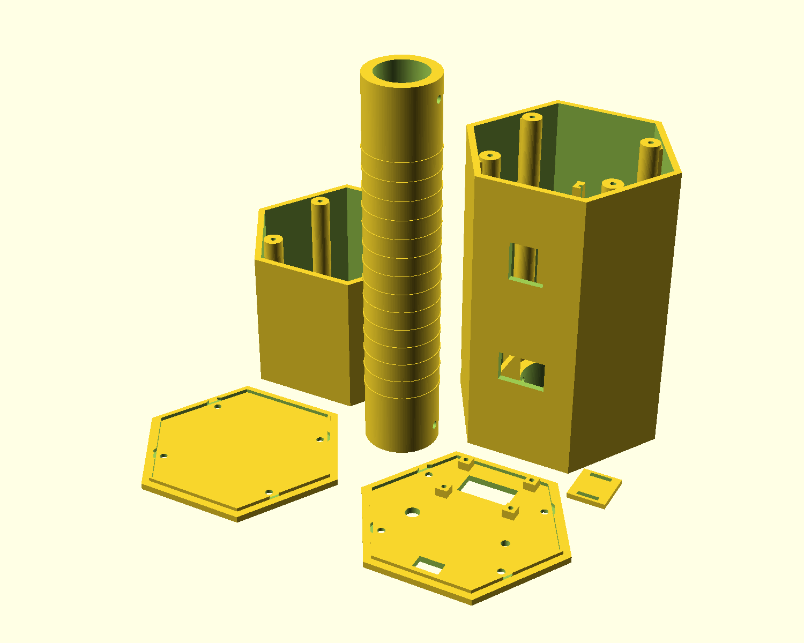

# Print sheet: Smart Dumbbell, plan A v0.7

ECE 198 Group 57. One file: **`Smart_Dumbbell_planA_v07_print_plate.stl`**

| | |
|---|---|
| Units and scale | millimetres, 100 %. Do not scale. |
| Contents | 6 separate bodies, already in print orientation, all sitting on z = 0 |
| Footprint | 212 × 186 mm |
| Height | 180 mm (the grip); the tall head is 137 mm |
| Smallest gap between bodies | 3.2 mm |
| Solid volume | 420 cm³, about 520 g of PLA if printed solid. Not a slicer estimate. |

## The six bodies

| Body | Size (mm) | Orientation on the plate |
|---|---|---|
| Right head (tall, two side windows) | 100 × 87 × 137 | Closed floor down, open end up |
| Left head | 100 × 87 × 67 | Closed floor down, open end up |
| Right cap (window, tabs, holes) | 100 × 87 × 7 | Outer face down, lip and tabs up |
| Left cap | 100 × 87 × 5 | Outer face down, lip up |
| Grip | Ø 35 × 180 | Standing upright |
| Sensor carrier | 18 × 20 × 2.5 | Flat |

## Suggested settings

These are the settings from our earlier v0.4 request; please override them with your own judgement.

- PLA for this fit prototype. 0.20 mm layers, 4 wall loops, 20–30 % infill.
- Brim on the grip: it is 180 mm tall on a 35 mm footprint.
- Everything inside the heads rises straight from the floor, so no support is needed there. The only bridges are openings in walls: two windows in the tall head (16 and 22 mm wide), one window in the grip (14 mm wide) and a few 3–7 mm cross holes. Support for those is at your discretion.
- Please keep the orientation. The heads have long thin ribs and screw posts that only print well standing up.

## If the plate has to be split

The bodies do not touch. In Bambu Studio: right-click the object, Split, To Objects; each body can then be moved, supported or sent to another plate. The same six parts are also in this folder as single files (`head_right.stl`, `head_left.stl`, `cap_right.stl`, `cap_left.stl`, `grip.stl`, `max30102_carrier.stl`).

The grip needs a printer with at least 180 mm of Z travel.

## Please note

Prototype electronics enclosure for a course project. It has not been printed before and is not load rated. Four M3 self-tapping pilot holes per head and the cap screw holes may need clearing after printing.
