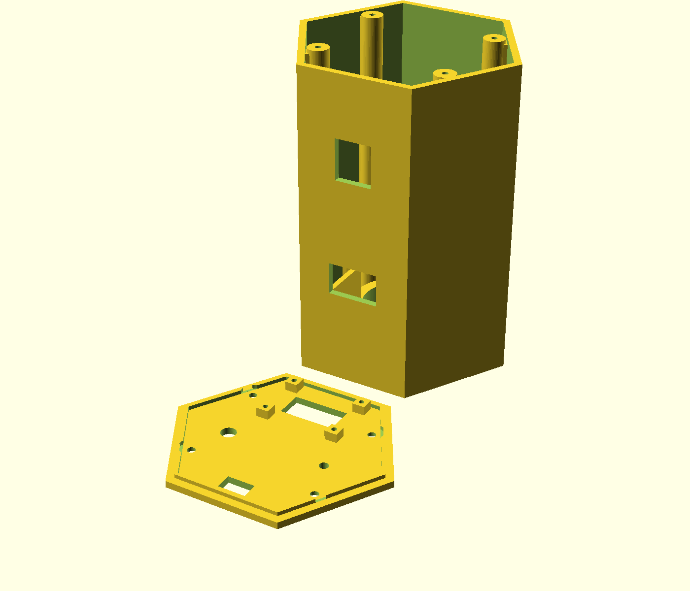

# Print sheet: Smart Dumbbell right head and right cap (plan A v0.7)

ECE 198 Group 57. One file: **`Smart_Dumbbell_planA_v07_right_head_and_cap.stl`**

These two parts replace the `head_right` and `cap_right` of our earlier v0.4 request. The other three parts of that request (`head_left`, `cap_left`, `grip`) are unchanged and fit these.

| | |
|---|---|
| Units and scale | millimetres, 100 %. Do not scale. |
| Contents | 2 separate bodies, already in print orientation, both sitting on z = 0, 12 mm apart |
| Footprint | 100 × 185 mm |
| Height | 137 mm |
| Solid volume | 221 cm³, about 275 g of PLA if printed solid. Not a slicer estimate. |

| Body | Size (mm) | Orientation |
|---|---|---|
| Right head (two windows in one side wall) | 100 × 87 × 137 | Closed floor down, open end up |
| Right cap (window, four tabs, two round holes) | 100 × 87 × 7 | Outer face down, lip and tabs up |

## Suggested settings

Please override these with your own judgement.

- PLA for this fit prototype. 0.20 mm layers, 4 wall loops, 20–30 % infill.
- Please keep the orientation. Everything inside the head (ribs, board slots, four screw posts, the round collar) rises straight from the floor and only prints well standing up. No support is needed inside.
- The only bridges are two rectangular windows in one side wall of the head, 16 mm and 22 mm wide, and two small cross holes near its floor. Support for those is at your discretion.

The two bodies do not touch. In Bambu Studio: right-click, Split, To Objects, if you want to move them. They are also available as single files, `head_right.stl` and `cap_right.stl`.

## Please note

Prototype electronics enclosure for a course project. These parts have not been printed before and are not load rated. The four M3 self-tapping pilot holes at the top of the screw posts may need clearing after printing.
